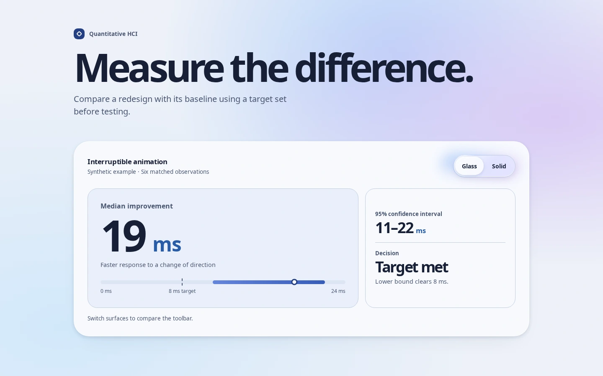

# Quantitative HCI

<p align="center">
  
</p>

<p align="center">
  
</p>

<p align="center">
  <a href="LICENSE"></a>
  
  
  
</p>

A structured HCI and UX review skill pack for prototypes, flows, interface systems, research planning, and usability evaluation. It focuses on models, journeys, terminology, state handling, consistency, failure paths, heuristics, cognitive walkthroughs, personas, task analysis, prototype planning, and usability studies.

## Liquid Glass UI kit

Use the shared **WebGPU Liquid Glass kit** for new high-fidelity internal interfaces without an established product design system. Real [Vercel UI SDK](https://github.com/vercel-labs/ui) controls retain their behaviour while a shared renderer applies the reference-based material to actual buttons, fields, panels and popups.

**[Open the Liquid Glass UI kit](https://quantitative-hci-ui-sdk-demos.ajax414655.chatgpt.site/)** (owner access): use the default overview, adjust refraction and colour dispersion in Material settings, choose a backdrop, and explore all **55 component families** through the searchable catalogue.

**Studio typography and Isometric icons are the defaults.** Material settings lets you switch between Studio (Manrope), Editorial (Fraunces headings with Manrope interface text) and System fonts, and between Isometric and Line icons. The demo remembers valid choices, and Copy starter includes your selected font and icon presets.

**Graphics** adds an editable image/text/shape canvas with stable layer IDs, transforms, undo/redo, variants, validated JSON, self-contained SVG export and an image-agent brief/context handoff. Existing image cards, gallery, detail dialogs and comparisons remain under **Image components**. **Standards** adds **46 editable views**, including 11 labelled UWE views, all seven C4 view types and three agent-model views. The catalogue has 291 entries: 286 official OMG versions plus explicitly attributed additions. Coverage is 9 notation subsets, 5 concept projections and 277 reference entries. A revisioned model document gives people and agents the same atomic edits, previews, validation and history. **Agents** adds reusable capability, status, timeline, tool-request, artifact and context components with an interactive local review workflow. No protocol transport, remote model provider or complete standards conformance is implied. See the [component contract](docs/hci/standards/standards-components.md), [coverage registry](docs/hci/standards/omg-coverage.md), [agent-first modeling architecture](docs/hci/standards/agent-first-modeling.md) and [worked exploration model](docs/hci/models/developer-model-exploration.md).

Every custom component and composition is **Unvalidated**, meaning a human UI/UX team has not reviewed or approved it. The original 55 families are marked **SDK foundation**, identifying upstream Vercel behaviour rather than approval of our glass adaptation. Engineering checks and human review status remain distinct.

The [implementation standard](docs/hci/standards/liquid-glass.md), [agent instructions](AGENTS.md), pinned SDK packages and browser contracts define the integration. GPU tests compare real control rectangles, strength changes, backdrop recapture and top-layer popups. The SDK agent bridge remains beneath the UI for verification; the hosted kit has no diagnostic workbench, inspector or settings pilot.

Use the [interface foundations](docs/hci/standards/interface-foundations.md) to turn a real task into content, navigation, presentation and state decisions, then select the measurements that can justify a change. The [kit customization model](docs/hci/models/kit-customization-model.md) provides a concrete worked contract for font/icon choices, state retention and evaluation. Visual defaults and automated rendering checks are distinct from measured human usability.

```bash
npm ci --ignore-scripts
npm run glass:dev
npm run glass:verify
```

Read the [kit guide](docs/hci/examples/liquid-glass/README.md) for rendering boundaries, fallbacks and verification, and the [reusable package](packages/liquid-glass/README.md) for integration. The earlier toolbar study below remains an independent fixture with its own evidence.



Open [the example HTML](docs/hci/examples/spotlight-glass.html) locally to compare Glass and Solid on the same toolbar. The [design guidance](docs/hci/examples/README.md) covers surface selection, what to measure and how to run the browser audit. [Apple materials](https://developer.apple.com/design/human-interface-guidelines/materials) · [21st.dev border-only Spotlight](https://21st.dev/?q=spotlight+card&preview=%2F%40ibelick%2Fcomponents%2Fspotlight%2Fborder-only)

## Quantitative models

The [interface design catalogue](docs/hci/models/interface-design-models.md) covers 20 terms from typography, layout, interaction and motion. Each entry defines what to measure and how to interpret it.

Run the calculator against the [synthetic examples](docs/hci/models/example-measurements.json) with Python 3.9+.

```bash
python3 docs/hci/models/measure.py docs/hci/models/example-measurements.json
```

Use the [evaluation protocol](docs/hci/models/evaluation-protocol.md) to collect matched observations and compare a candidate with a baseline. The paired calculator reports the median gain, its uncertainty and whether it clears the improvement you specified.

```bash
python3 -B docs/hci/models/compare.py docs/hci/models/example-comparison.json
```

The [Chromium benchmark](docs/hci/models/browser-benchmark.md) captures real browser measurements for 11 models across desktop, mobile and reduced-motion fixtures.

The [UI SDK settings pilot](docs/hci/examples/ui-sdk-pilot/README.md) compares native controls, SDK controls, and structured agent actions using the same tasks. Its [fixed protocol](docs/hci/models/ui-sdk-pilot-protocol.md) separates task correctness, scripted execution cost, and bundle size from unmeasured model or human performance.

[Measured pilot results](docs/hci/models/ui-sdk-pilot-results.md): 162/162 scripted tasks and 33/33 additional checks passed. The native reference was faster and smaller; no model-token, development-speed or human-usability gain was measured.

The former settings demo lab is archived as a local source fixture. Its [demo guide](docs/hci/models/ui-sdk-demo-guide.md) preserves reproduction instructions; the hosted site now serves the Liquid Glass kit.

## Included skills

### Core review skills

- `prototype-hci-pack`
- `conceptual-model`
- `state-model`
- `journey-map`
- `vocabulary-audit`
- `information-architecture`
- `consistency-audit`
- `failure-path-audit`
- `heuristic-eval`
- `cognitive-walkthrough`

### Research and prototyping skills

- `accessibility-precheck`
- `cognitive-friction-detector`
- `error-and-time-metrics-analyzer`
- `field-study-planner`
- `high-fidelity-prototype-planner`
- `interaction-type-selector`
- `low-fidelity-prototype-planner`
- `mental-model-checker`
- `persona-synthesizer`
- `representative-task-writer`
- `satisfaction-questionnaire-writer`
- `task-analysis-writer`
- `usability-test-planner`
- `wireframe-critic`

### Beads variants

- `prototype-hci-pack-beads`
- `conceptual-model-beads`
- `state-model-beads`
- `journey-map-beads`
- `vocabulary-audit-beads`
- `information-architecture-beads`
- `consistency-audit-beads`
- `failure-path-audit-beads`
- `heuristic-eval-beads`
- `cognitive-walkthrough-beads`

## Features

- Reviews real interfaces as systems, not isolated screens
- Produces durable markdown artifacts under `docs/hci/`
- Includes diagrams, scorecards, summaries, and structured review outputs
- Adds research-planning and prototyping skills for personas, task analysis, testing, accessibility, and wireframe critique
- Ships both core review skills and Beads-backed issue-generation variants
- Mirrors packaged skills into both `.claude/skills/` and `.agents/skills/`

## Install

### Option A: Install globally

```bash
git clone https://github.com/45ck/hci-review-skill.git quantitative-hci
cd quantitative-hci
bash install.sh
```

This installs every packaged skill into both:

- `~/.claude/skills/`
- `~/.agents/skills/`

### Option B: Copy into a project

```bash
cp -R .claude /path/to/your-project/
cp -R .agents /path/to/your-project/
```

### Uninstall

```bash
bash uninstall.sh
```

## Usage

```text
/prototype-hci-pack onboarding flow
/conceptual-model approval system
/state-model request lifecycle
/journey-map first-time user onboarding
/vocabulary-audit approval + request + task terminology
/information-architecture main navigation and settings
/consistency-audit settings, approvals, and notifications
/failure-path-audit checkout flow
/heuristic-eval approval dashboard
/cognitive-walkthrough create-new-agent flow
/persona-synthesizer interview notes for student onboarding
/task-analysis-writer submit expense claim
/mental-model-checker current dashboard concepts
/accessibility-precheck account setup flow
/low-fidelity-prototype-planner early concept for scheduling flow
/wireframe-critic checkout wireframes
/usability-test-planner prototype validation session

/heuristic-eval-beads approval dashboard
/prototype-hci-pack-beads onboarding flow
```

## Repo structure

```text
.claude/skills/<skill>/SKILL.md      packaged skill format
.agents/skills/<skill>/SKILL.md      mirrored packaged skill format
docs/hci/                            templates and generated review artifacts
install.sh                           global installer
uninstall.sh                         global uninstaller
LICENSE                              MIT
```

## Related workflow agents

- [ux-researcher](https://github.com/45ck/skill-harness) - Plan and critique UX research, usability work, and prototype evaluation
- [system-modeler](https://github.com/45ck/skill-harness) - Formalize user flows and behavioral models where needed

## Related skill packs

- [business-analysis-skills](https://github.com/45ck/business-analysis-skills) - Business analysis techniques, workflows, and quality checks
- [marketing-product-skills](https://github.com/45ck/marketing-product-skills) - Product strategy, growth, positioning, launch, SEO, and pricing skills
- [fagan-inspection-skill](https://github.com/45ck/fagan-inspection-skill) - Formal inspection and defect-review skills
- [software-architecture-skills](https://github.com/45ck/software-architecture-skills) - Architecture options, views, risks, and tradeoff writing
- [data-structures-algorithmic-reasoning-skills](https://github.com/45ck/data-structures-algorithmic-reasoning-skills) - Data structure selection and algorithmic reasoning skills
- [oop-code-structure-skills](https://github.com/45ck/oop-code-structure-skills) - Object-oriented design and class-structure review skills
- [web-engineering-skills](https://github.com/45ck/web-engineering-skills) - Web request handling, MVC, validation, routing, and navigation skills
- [backend-persistence-skills](https://github.com/45ck/backend-persistence-skills) - Persistence, schema, ORM, query, and migration skills
- [enterprise-architecture-integration-skills](https://github.com/45ck/enterprise-architecture-integration-skills) - Enterprise topology, integration, messaging, and cloud skills
- [uml-analysis-modelling-skills](https://github.com/45ck/uml-analysis-modelling-skills) - UML analysis and modelling skills
- [verification-test-design-skills](https://github.com/45ck/verification-test-design-skills) - Verification, coverage, decision-table, and oracle design skills
- [automation-testing-skills](https://github.com/45ck/automation-testing-skills) - Unit, integration, API, UI, regression, and flaky-test skills
- [non-functional-testing-skills](https://github.com/45ck/non-functional-testing-skills) - Performance, resilience, scalability, soak, stress, and NFR testing skills
- [software-quality-skills](https://github.com/45ck/software-quality-skills) - Quality models, technical debt, maintainability, and reliability skills
- [code-review-inspection-skills](https://github.com/45ck/code-review-inspection-skills) - Formal inspection, checklist-driven review, metrics, and rework planning skills
- [refactoring-code-smells-skills](https://github.com/45ck/refactoring-code-smells-skills) - Refactoring, anti-pattern, duplication, and code smell review skills
- [design-for-testability-skills](https://github.com/45ck/design-for-testability-skills) - Seams, DI, determinism, hidden I/O, and testability design skills
- [security-engineering-skills](https://github.com/45ck/security-engineering-skills) - Threat modeling, boundaries, least privilege, and secure defaults skills
- [authentication-cryptography-skills](https://github.com/45ck/authentication-cryptography-skills) - Authentication, token, certificate, revocation, and MITM review skills
- [pentest-security-testing-skills](https://github.com/45ck/pentest-security-testing-skills) - Pentest scoping, recon, attack-surface mapping, OWASP, and finding-report skills
- [llm-agent-security-skills](https://github.com/45ck/llm-agent-security-skills) - Prompt injection, agent permissions, retrieval trust, memory, and tool-chain security skills
- [deployment-release-skills](https://github.com/45ck/deployment-release-skills) - Deployment strategy, go-live readiness, rollback, and release operations skills
- [maintenance-evolution-skills](https://github.com/45ck/maintenance-evolution-skills) - Maintenance triage, change impact, migration, regression, and deprecation skills
- [project-management-skills](https://github.com/45ck/project-management-skills) - Project chartering, scope, WBS, milestones, estimation, and closure skills
- [agile-delivery-skills](https://github.com/45ck/agile-delivery-skills) - Backlog shaping, sprint goals, retrospectives, blockers, and delivery discipline skills
- [cloud-platform-operations-skills](https://github.com/45ck/cloud-platform-operations-skills) - Cloud placement, rollout readiness, patching, migration waves, and lifecycle operations skills
- [documentation-evidence-skills](https://github.com/45ck/documentation-evidence-skills) - Specifications, rationale, reports, traceability, plans, and evidence quality skills
- [research-literature-review-skills](https://github.com/45ck/research-literature-review-skills) - Search strategy, screening, synthesis, evidence strength, and gap-analysis skills


## Related doctrine and utility repos

- [frontier-agent-playbook](https://github.com/45ck/frontier-agent-playbook) - Shared doctrine for frontier-capability prior, agentic thinking, anti-fallback checks, and LLM-first architecture
- [repo-branding-skill](https://github.com/45ck/repo-branding-skill) - Repository branding, banner generation, and README/social preview asset creation

## License

[MIT](LICENSE)

Kit verification uses Node 24 (also pinned in CI) and Python 3. Model checks execute the real typed scene sources, validate all 46 registered views and their cross-view links, reject malformed imports, and parse every SVG as XML. Separate source checks exercise UWE/C4 semantics, revisioned atomic documents and ordered agent tasks; production browser checks exercise the actual SDK agent bridge and human controls.
