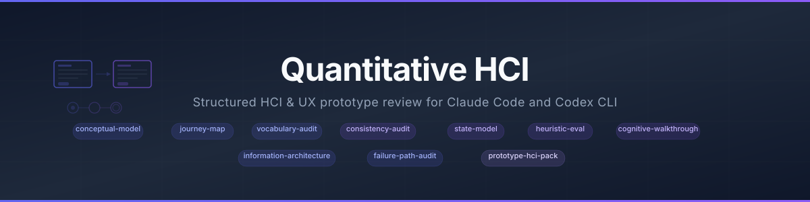

# hci-review-skill

<p align="center">
  
</p>

<p align="center">
  
</p>

<p align="center">
  <a href="LICENSE"></a>
  
  
  
</p>

A structured HCI and UX review skill pack for prototypes, flows, interface systems, research planning, and usability evaluation. It focuses on models, journeys, terminology, state handling, consistency, failure paths, heuristics, cognitive walkthroughs, personas, task analysis, prototype planning, and usability studies.

## Repository scope

This repository maintains the specialist HCI review skills, research-planning workflows, and their templates. Quantive's design system, quantitative modelling tools, and internal components are maintained separately in a private repository.

## Included skills

### Core review skills

- `prototype-hci-pack`
- `conceptual-model`
- `state-model`
- `journey-map`
- `vocabulary-audit`
- `information-architecture`
- `consistency-audit`
- `failure-path-audit`
- `heuristic-eval`
- `cognitive-walkthrough`

### Research and prototyping skills

- `accessibility-precheck`
- `cognitive-friction-detector`
- `error-and-time-metrics-analyzer`
- `field-study-planner`
- `high-fidelity-prototype-planner`
- `interaction-type-selector`
- `low-fidelity-prototype-planner`
- `mental-model-checker`
- `persona-synthesizer`
- `representative-task-writer`
- `satisfaction-questionnaire-writer`
- `task-analysis-writer`
- `usability-test-planner`
- `wireframe-critic`

### Beads variants

- `prototype-hci-pack-beads`
- `conceptual-model-beads`
- `state-model-beads`
- `journey-map-beads`
- `vocabulary-audit-beads`
- `information-architecture-beads`
- `consistency-audit-beads`
- `failure-path-audit-beads`
- `heuristic-eval-beads`
- `cognitive-walkthrough-beads`

### Design principle reviews

Seven focused skills turn familiar design principles into concrete checks against screenshots, code, interaction traces, and user evidence. They reuse the current design system, custom icons, and global theme/motion settings. Each produces findings, a proposed change, verification steps, and evidence limits.

| Skill | What it checks |
| --- | --- |
| [jakobs-law-review](.agents/skills/jakobs-law-review/SKILL.md) | Whether a familiar control's actual behavior matches its apparent meaning |
| [hicks-law-review](.agents/skills/hicks-law-review/SKILL.md) | Competing choices at a specific decision, without hiding essential actions |
| [color-balance-review](.agents/skills/color-balance-review/SKILL.md) | Color roles, competing accents, themes, and independently measured contrast |
| [von-restorff-review](.agents/skills/von-restorff-review/SKILL.md) | Meaningful emphasis within a peer group, including truthful recommendations |
| [aesthetic-usability-review](.agents/skills/aesthetic-usability-review/SKILL.md) | Visual coherence and actual task usability as separate questions |
| [peak-end-review](.agents/skills/peak-end-review/SKILL.md) | Demanding moments, accurate completion, recovery, and useful endings |
| [zeigarnik-progress-review](.agents/skills/zeigarnik-progress-review/SKILL.md) | Honest progress, optional steps, saved work, and reliable resumption |

The skills are self-contained after installation. They do not require a private runtime, a paid model, or a scoring framework. Their descriptions support task-based discovery; Codex metadata enables implicit invocation for these seven skills where the host supports it. The full review pack routes to the relevant skill when a specific question arises, without requiring seven additional reports.

Read the [source mapping and evidence limits](docs/hci/design-principle-skills.md) and [validation record](docs/hci/design-principles-validation.md).

## Features

- Reviews real interfaces as systems, not isolated screens
- Produces durable markdown artifacts under `docs/hci/`
- Includes diagrams, scorecards, summaries, and structured review outputs
- Adds research-planning and prototyping skills for personas, task analysis, testing, accessibility, and wireframe critique
- Ships both core review skills and Beads-backed issue-generation variants
- Mirrors packaged skills into both `.claude/skills/` and `.agents/skills/`

## Install

### Option A: Install globally

```bash
git clone https://github.com/45ck/hci-review-skill.git
cd hci-review-skill
bash install.sh
```

This installs every packaged skill into both:

- `~/.claude/skills/`
- `~/.agents/skills/`

The installer and uninstaller share the inventory in `skills.txt`. To use an isolated target without changing your home directory, set an absolute `HCI_SKILLS_HOME` path for either command.

### Option B: Copy into a project

```bash
cp -R .claude /path/to/your-project/
cp -R .agents /path/to/your-project/
```

### Uninstall

```bash
bash uninstall.sh
```

## Usage

```text
/prototype-hci-pack onboarding flow
/conceptual-model approval system
/state-model request lifecycle
/journey-map first-time user onboarding
/vocabulary-audit approval + request + task terminology
/information-architecture main navigation and settings
/consistency-audit settings, approvals, and notifications
/failure-path-audit checkout flow
/heuristic-eval approval dashboard
/cognitive-walkthrough create-new-agent flow
/persona-synthesizer interview notes for student onboarding
/task-analysis-writer submit expense claim
/mental-model-checker current dashboard concepts
/accessibility-precheck account setup flow
/low-fidelity-prototype-planner early concept for scheduling flow
/wireframe-critic checkout wireframes
/usability-test-planner prototype validation session
/jakobs-law-review report editor controls
/hicks-law-review dashboard primary actions
/color-balance-review light and dark themes
/von-restorff-review pricing comparison priorities
/aesthetic-usability-review account settings
/peak-end-review report submission and retry
/zeigarnik-progress-review onboarding checklist and resume flow

/heuristic-eval-beads approval dashboard
/prototype-hci-pack-beads onboarding flow
```

## Repo structure

```text
.claude/skills/<skill>/SKILL.md      packaged skill format
.agents/skills/<skill>/SKILL.md      mirrored packaged skill format
docs/hci/                            templates and generated review artifacts
skills.txt                           shared install/uninstall inventory
scripts/verify_skill_pack.py         dependency-free package and installation checks
install.sh                           global installer
uninstall.sh                         global uninstaller
LICENSE                              MIT
```

## Verify changes

```bash
bash -n install.sh uninstall.sh scripts/skill_inventory.sh
python3 scripts/verify_skill_pack.py
```

The required `verify` CI job checks inventories, skill metadata, core mirrors, descriptors, local links, and installation/removal in a temporary target. It preserves the existing Beads variants and does not install into the contributor's home directory. Package checks and agent review exercises do not establish human usability outcomes.

## Related workflow agents

- [ux-researcher](https://github.com/45ck/skill-harness) - Plan and critique UX research, usability work, and prototype evaluation
- [system-modeler](https://github.com/45ck/skill-harness) - Formalize user flows and behavioral models where needed

## Related skill packs

- [business-analysis-skills](https://github.com/45ck/business-analysis-skills) - Business analysis techniques, workflows, and quality checks
- [marketing-product-skills](https://github.com/45ck/marketing-product-skills) - Product strategy, growth, positioning, launch, SEO, and pricing skills
- [fagan-inspection-skill](https://github.com/45ck/fagan-inspection-skill) - Formal inspection and defect-review skills
- [software-architecture-skills](https://github.com/45ck/software-architecture-skills) - Architecture options, views, risks, and tradeoff writing
- [data-structures-algorithmic-reasoning-skills](https://github.com/45ck/data-structures-algorithmic-reasoning-skills) - Data structure selection and algorithmic reasoning skills
- [oop-code-structure-skills](https://github.com/45ck/oop-code-structure-skills) - Object-oriented design and class-structure review skills
- [web-engineering-skills](https://github.com/45ck/web-engineering-skills) - Web request handling, MVC, validation, routing, and navigation skills
- [backend-persistence-skills](https://github.com/45ck/backend-persistence-skills) - Persistence, schema, ORM, query, and migration skills
- [enterprise-architecture-integration-skills](https://github.com/45ck/enterprise-architecture-integration-skills) - Enterprise topology, integration, messaging, and cloud skills
- [uml-analysis-modelling-skills](https://github.com/45ck/uml-analysis-modelling-skills) - UML analysis and modelling skills
- [verification-test-design-skills](https://github.com/45ck/verification-test-design-skills) - Verification, coverage, decision-table, and oracle design skills
- [automation-testing-skills](https://github.com/45ck/automation-testing-skills) - Unit, integration, API, UI, regression, and flaky-test skills
- [non-functional-testing-skills](https://github.com/45ck/non-functional-testing-skills) - Performance, resilience, scalability, soak, stress, and NFR testing skills
- [software-quality-skills](https://github.com/45ck/software-quality-skills) - Quality models, technical debt, maintainability, and reliability skills
- [code-review-inspection-skills](https://github.com/45ck/code-review-inspection-skills) - Formal inspection, checklist-driven review, metrics, and rework planning skills
- [refactoring-code-smells-skills](https://github.com/45ck/refactoring-code-smells-skills) - Refactoring, anti-pattern, duplication, and code smell review skills
- [design-for-testability-skills](https://github.com/45ck/design-for-testability-skills) - Seams, DI, determinism, hidden I/O, and testability design skills
- [security-engineering-skills](https://github.com/45ck/security-engineering-skills) - Threat modeling, boundaries, least privilege, and secure defaults skills
- [authentication-cryptography-skills](https://github.com/45ck/authentication-cryptography-skills) - Authentication, token, certificate, revocation, and MITM review skills
- [pentest-security-testing-skills](https://github.com/45ck/pentest-security-testing-skills) - Pentest scoping, recon, attack-surface mapping, OWASP, and finding-report skills
- [llm-agent-security-skills](https://github.com/45ck/llm-agent-security-skills) - Prompt injection, agent permissions, retrieval trust, memory, and tool-chain security skills
- [deployment-release-skills](https://github.com/45ck/deployment-release-skills) - Deployment strategy, go-live readiness, rollback, and release operations skills
- [maintenance-evolution-skills](https://github.com/45ck/maintenance-evolution-skills) - Maintenance triage, change impact, migration, regression, and deprecation skills
- [project-management-skills](https://github.com/45ck/project-management-skills) - Project chartering, scope, WBS, milestones, estimation, and closure skills
- [agile-delivery-skills](https://github.com/45ck/agile-delivery-skills) - Backlog shaping, sprint goals, retrospectives, blockers, and delivery discipline skills
- [cloud-platform-operations-skills](https://github.com/45ck/cloud-platform-operations-skills) - Cloud placement, rollout readiness, patching, migration waves, and lifecycle operations skills
- [documentation-evidence-skills](https://github.com/45ck/documentation-evidence-skills) - Specifications, rationale, reports, traceability, plans, and evidence quality skills
- [research-literature-review-skills](https://github.com/45ck/research-literature-review-skills) - Search strategy, screening, synthesis, evidence strength, and gap-analysis skills


## Related doctrine and utility repos

- [frontier-agent-playbook](https://github.com/45ck/frontier-agent-playbook) - Shared doctrine for frontier-capability prior, agentic thinking, anti-fallback checks, and LLM-first architecture
- [repo-branding-skill](https://github.com/45ck/repo-branding-skill) - Repository branding, banner generation, and README/social preview asset creation

## License

[MIT](LICENSE)
