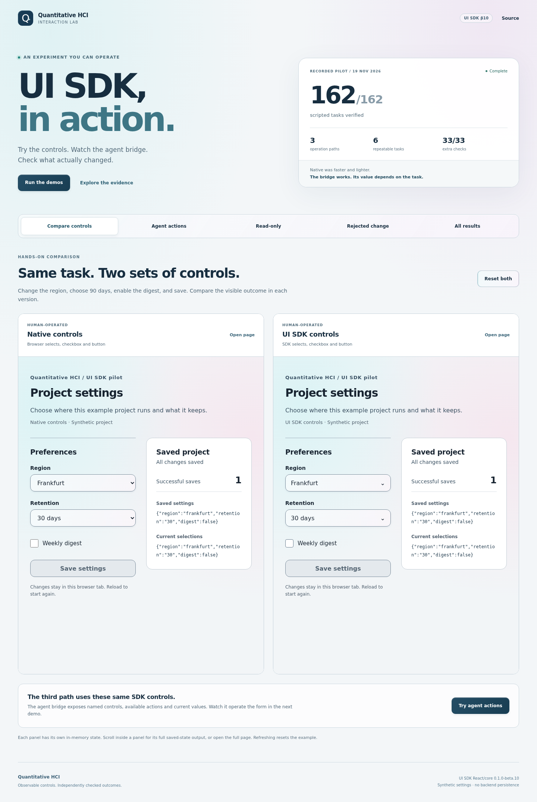

# UI SDK demo acceptance — 19 November 2026

**The five-view demo lab is published and its final browser integration run passed 15/15 checks.** Open the [private demo lab](https://quantitative-hci-ui-sdk-demos.ajax414655.chatgpt.site) and follow the [demo guide](ui-sdk-demo-guide.md).

## What is available

| View | Purpose |
| --- | --- |
| Compare controls | Independently editable native and SDK forms, full-page links, reset |
| Agent actions | Real SDK snapshots/actions; T1–T6 individually or as a suite |
| Read-only | A blocked region mutation with unchanged rendered state |
| Rejected change | Deliberate retention cancellation; response and actual outcome shown together |
| All results | All 162 original attempts, 33 guardrails, six captures and downloadable evidence |

Every replay starts from a fresh fixture. The verifier reads rendered draft state, saved state, save count and Save's disabled state outside the bridge response. The scripts make no model calls and all saved settings remain in page memory.

## Final acceptance

The [successful CI run](https://github.com/45ck/hci-review-skill/actions/runs/44412607492) tested application revision `44ba4d4585e99ca2a85cdb3d398612ae9799298b`, through PR merge revision `cd9c1b4da17412280b69bdab3d8bf23d2612c1d2`. Demo checks finished at **19 November 2026, 09:36:45 AEDT** using Chromium `159.0.8154.6`.

| Check | Outcome |
| --- | --- |
| `compare-manual` | Passed |
| `replay-t1` | Passed |
| `replay-t2` | Passed |
| `replay-t3` | Passed |
| `replay-t4` | Passed |
| `replay-t5` | Passed |
| `replay-t6` | Passed |
| `inspect-and-reset` | Passed |
| `six-task-suite` | Passed |
| `readonly` | Passed |
| `rejection` | Passed |
| `recorded-results` | Passed |
| `mobile-compare` | Passed |
| `mobile-agent-replay` | Passed |
| `mobile-recorded-results` | Passed |

All 15 checks reported zero page errors. They cover manual native/SDK controls, six individual bridge tasks, inspection/reset, the six-task suite, both guard scenarios, desktop/mobile evidence filtering, mobile comparison and replay, and horizontal page overflow. The results checks load all 162 trials and 33 guardrails, filter to three mobile bridge T6 attempts and eleven mobile guardrails, and validate the served raw gzip report, CSV, original manifest and all six PNG payloads.

The same CI job also passed **162/162 matched fixture attempts**, **33/33 additional checks**, **11 Python tests**, TypeScript and the production build. This is regression evidence for the demo addition. It does not replace or pool data with the [original canonical performance report](ui-sdk-pilot-results.md).

## Initial failure and correction

The [first CI run](https://github.com/45ck/hci-review-skill/actions/runs/44411587936) passed 162/162 fixture attempts and 33/33 guardrails, but passed only **13/15 demo checks**. Desktop and mobile results checks could not resolve the exact Profile label: the wrapping label's descendant option text was included by Playwright's label lookup.

The correction added explicit accessible names to the Profile, Operation path and Task filters, and the timing profile selector. The exact semantic checker was preserved. The final run above passed all 15 checks. Both runs remain identified; the initial failures are not excluded from this history.

## Publication and review scope

Site **version 2** was published successfully from source `60c97a0703cac7416a8ed964cb1ad9e63ac1c04a`. Its application files match the tested GitHub source. Access remains private to the owner. The hosted URL displayed the expected ChatGPT sign-in gate in the cloud browser; an authenticated production browsing session was not exercised there.

Interactive preview review completed all six task replays and both guard scenarios. Final CI exercised the corrected production build served locally, including mobile layouts. Representative CI captures are retained below; these are actual browser screenshots, not mockups.

[Agent task T4 capture](../results/ui-sdk-demos-2026-11-19/agent-task-t4.png) · [Mobile agent capture](../results/ui-sdk-demos-2026-11-19/mobile-agent.png)

## Durable evidence

- [Complete demo check report, gzip](../results/ui-sdk-demos-2026-11-19/demo-checks.json.gz)
- [Complete regression report, gzip](../results/ui-sdk-demos-2026-11-19/regression-results.json.gz)
- [Source, publication and hash provenance](../results/ui-sdk-demos-2026-11-19/provenance.json)
- [Complete CI archive](https://github.com/45ck/hci-review-skill/actions/runs/44412607492/artifacts/14477966736) — includes the runnable build and all new captures; normal 30-day CI retention applies.

The original benchmark's timing and bundle figures remain explicitly tied to its original build. The demo adds presentation assets and deliberate replay pacing. It establishes neither model token/cost savings nor human usability or development-speed improvements.
