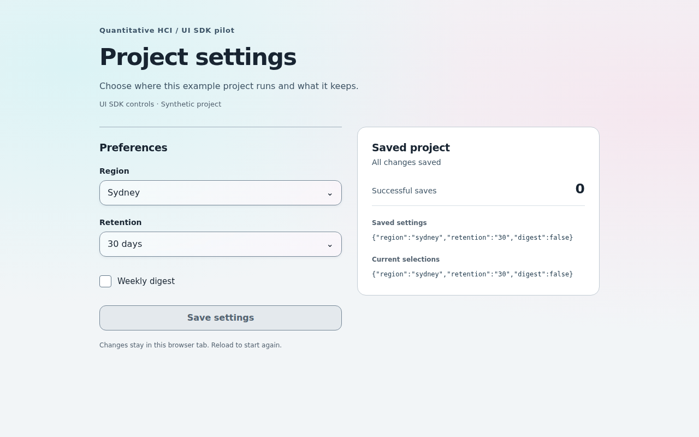

# UI SDK pilot results — 19 November 2026

**Decision: retain this as an opt-in experiment.** The SDK controls and structured agent interface completed every scripted settings task, but the native reference was faster and smaller. This fixture establishes feasibility; it does not establish a reason to replace ordinary controls across projects.

The [example and reproduction commands](../examples/ui-sdk-pilot/README.md), [fixed protocol](ui-sdk-pilot-protocol.md), and [successful canonical CI run](https://github.com/45ck/hci-review-skill/actions/runs/44400965977) are available with [PR #1](https://github.com/45ck/hci-review-skill/pull/1).

## What ran

The same synthetic settings workflow was operated through three paths: native React controls using browser automation, UI SDK controls using browser automation, and those same SDK controls through `createAgent`. All paths shared validation and in-memory save logic. The native page is a new reference fixture, not an existing customer application.

Six tasks covered changing individual settings, changing all settings, restoring the original values without saving, and saving two successive changes. Three fresh repetitions ran on desktop, emulated mobile, and emulated mobile with reduced motion. Arm order rotated; every attempt used a fresh browser context. The verifier read rendered draft state, saved state, save count and disabled state independently of the bridge response.

| Outcome | Native DOM | SDK DOM | SDK bridge |
| --- | ---: | ---: | ---: |
| Verified routine tasks | 54 / 54 | 54 / 54 | 54 / 54 |
| Semantic actions attempted | 198 | 198 | 198 |
| Harness action commands | 198 | 297 | 198 |
| Observed page errors during routine tasks | 0 | 0 | 0 |

**162 / 162 routine attempts passed.** Separately, **33 / 33 guardrail checks passed**. The existing calculators and evidence-preservation checks passed **11 Python tests**, and the TypeScript/production build passed.

These denominators describe fixed scenarios and browser repetitions. They are not independent users, general workflow samples or a production reliability estimate.

## Execution time

Median scripted task duration in milliseconds; each cell contains 18 completed attempts. Timing starts after page readiness and includes the chosen driver operations, waiting and independent final verification.

| Profile | Native DOM | SDK DOM | SDK bridge |
| --- | ---: | ---: | ---: |
| Desktop, 1280 × 800 | 97.3 ms | 171.9 ms | 256.9 ms |
| Mobile, 390 × 844 | 96.5 ms | 172.3 ms | 258.5 ms |
| Reduced motion, 390 × 844 | 97.8 ms | 161.8 ms | 259.2 ms |

The within-task paired median differences, **SDK DOM minus SDK bridge**, were −81.8 ms, −80.4 ms and −81.8 ms respectively. The bridge was slower in every recorded matched pair in this run.

Per profile, the SDK browser adapter used 99 action commands versus 66 for the bridge. The native adapter also used 66. This difference follows the selected adapters: a custom select uses an open-and-click sequence, while native selection and a bridge action each use one harness command. Every bridge request contained one semantic step; batching did not create the difference.

The bridge and browser drivers have different event and waiting paths. The installed SDK waits for render settlement during its actions. These timings therefore describe this implementation and these scripts; they are not model latency, human task time or a pure component-speed comparison. No model inference or model tool loop ran.

## Bundle cost

Production JavaScript and CSS, with shared entry dependencies counted once. Gzip is computed separately per asset at level 9 with a fixed timestamp. HTML and source maps are excluded.

| Assets | Native reference | SDK candidate | SDK increment |
| --- | ---: | ---: | ---: |
| Initial, uncompressed | 229,734 B | 401,060 B | +171,326 B |
| Initial, gzip | 71,469 B | 131,500 B | **+60,031 B** |
| All reachable assets, gzip | 71,469 B | 145,207 B | **+73,738 B** |

All-reachable size includes the SDK's deferred sheet-presentation code; it does not mean every asset loaded in every trial. These are this small build's asset totals, not a universal SDK package size or network-transfer measurement.

## The useful correctness finding

The deliberate cancellation case requested retention `365` when the application allowed at most 90 days. In all three profiles the bridge returned:

```json
{
  "ok": true,
  "steps": [{"step": 0, "ref": "c2", "result": false}],
  "values": {"c2 Retention": "30"}
}
```

This is an abbreviated excerpt of the recorded response. The requested value was not applied, retention remained `30`, and the save count remained zero. The independent verifier correctly identified the unchanged state.

The application intentionally cancelled that change, and the response included the failed step result. **Top-level `ok: true` alone is insufficient evidence of task completion.** Integrations should inspect step results and verify the intended application outcome.

## Guardrails and visual review

For each of three profiles, the runner checked read-only save and edit attempts, missing references, unsupported actions, invalid option values, cancelled changes and repeated saving. It also checked actual Tab traversal through Region, Retention, Weekly digest and Save for both native and SDK pages, together with accessible labels and horizontal overflow. That yields 11 checks per profile, 33 total.

The disallowed cases left the observed application state unchanged. Several were rejected because the target was disabled, the action unsupported, or the value invalid before the explicit allowlist needed to decide. This does not independently prove every branch of the allow callback or any backend authorization policy. Saved state exists only in the page; no backend, tenant or authentication boundary was exercised.

The desktop SDK, mobile SDK and desktop native initial-state screenshots were visually reviewed. No blocking clipping, overlap or missing control was visible. Desktop control bounds matched. On mobile, raw JSON wraps inside a property name and the complete evidence panel needs scrolling; the form and Save remain visible. These captures show closed controls in their initial state. Focus, popup and post-save appearance were not visually certified, and the automated focus-style check is not a contrast or WCAG certification.



[Mobile SDK capture](../results/ui-sdk-pilot-2026-11-19/mobile-sdk-dom.png)

## What this supports

The repository now has a reproducible example of components exposing explicit state and actions, a narrow action policy, a shared validated state model, and an outcome verifier that detects a cancelled operation. It also has a reusable three-arm measurement harness and a measured bundle tradeoff.

For this simple settings form, the observed evidence supports keeping the native approach as the default. A future experiment can assess whether a model benefits from the structured interface on a more complex task. That would require equivalent tasks, the same model configuration, recorded prompts and full traces, actual token/cost accounting, and independent outcomes. The present run did **not** measure AI development speed, model task success, tokens, cash savings, engineer/reviewer effort, human usability or screen-reader performance.

## Reproducibility and evidence

| Field | Recorded value |
| --- | --- |
| Canonical run | [44400965977](https://github.com/45ck/hci-review-skill/actions/runs/44400965977) |
| Source branch head | `3ff819ec5339e09cf70036d0b4eb01ad18f0f69a` |
| Tested GitHub PR merge revision | `9e98d07fd8a108a66f063f5ca277db2c1e66e053` |
| Measurement window | 18 Nov 2026, 21:31:43–21:34:10 UTC; 19 Nov, 08:31:43–08:34:10 AEDT |
| Browser / driver | Chromium `159.0.8154.6`; Python Playwright `1.65.2` |
| Runtime | Node `24.22.2`; Python `3.13.18`; GitHub Ubuntu 24.04 runner |
| UI dependencies | React / React DOM `19.3.1`; UI SDK React/core `0.1.0-beta.10` |
| Tracked source state during measurement | Clean; fixture, runner, protocol and lockfile hashes are in the raw report |
| Original CI artifact SHA-256 | `a950d7b2adbf2b19498d663c806ff93451efcae887b798a791e6d5ec57ce840a` |
| Uncompressed raw report SHA-256 | `6ae94f8db5c28c30233cde91564493b2d1199d9646f30e931edcd8520da9194a` |

The canonical PR run was selected before its result was known. A separate push-triggered run also occurred; this report does not combine those attempts or select the faster run. Local Chromium launch was blocked by the execution environment, so no local browser result is included. No source correction was required after the canonical browser run. The subsequent evidence/report commit preserves the tested executable source.

- [Complete raw report, gzip-compressed](../results/ui-sdk-pilot-2026-11-19/results.json.gz): all 162 trial records, 33 guardrails, original observations and responses, timings, hashes and summary. Decompress with `gzip -dc results.json.gz` or Python's `gzip` module.
- [Per-trial metrics CSV](../results/ui-sdk-pilot-2026-11-19/trial-metrics.csv): convenient analysis view; the raw report remains authoritative.
- [Build manifest](../results/ui-sdk-pilot-2026-11-19/build-manifest.json): generated entry/dependency graph.
- [Original CI artifact](https://github.com/45ck/hci-review-skill/actions/runs/44400965977/artifacts/14473597045): complete runnable build, all six captures, JSON/JSONL and server log. The CI archive expires 18 December 2026; the raw report and representative captures above remain versioned in this repository.
